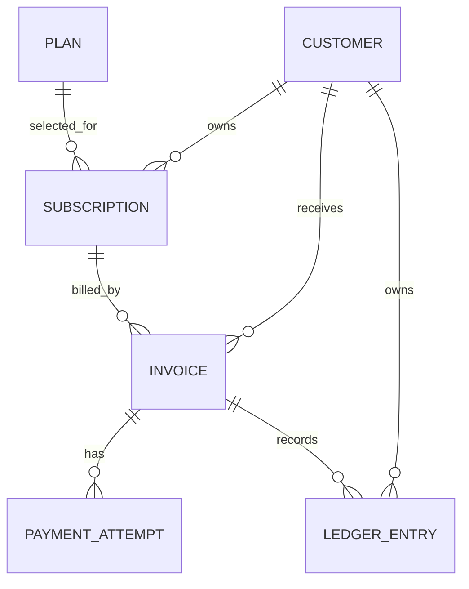

# SubLedger Low-Level Design

## Architecture
Routes -> Services -> Repositories -> SQLAlchemy Models -> Database. Pydantic schemas validate API inputs and outputs. Database session lifecycle and settings are centralized.

## Additional API – Plan Management

| Method | Endpoint | Purpose | Success |
|---|---|---|---|
| PATCH | /api/plans/{plan_id} | Activate or deactivate a plan | 200 OK |

Request:

```json
{
  "is_active": false
}
```

Returns 404 if the plan does not exist.

## ERD


## Domain model
- Plan: name, positive price, currency, billing interval, active flag.
- Customer: name, unique email.
- Subscription: customer, plan, status, start/end dates.
- Invoice: subscription, customer, amount due/paid, currency, status, billing period, due date.
- PaymentAttempt: invoice, amount, currency, status, provider reference, failure reason.
- LedgerEntry: customer, optional invoice, event type, amount, currency, reference ID, description, timestamp.

## Service responsibilities
| Service | Responsibility |
|---|---|
| PlanService | Positive price validation, plan creation, listing, activation and deactivation |
| CustomerService | Unique email validation and customer operations |
| SubscriptionService | Validate customer/plan, active plan and duplicate active subscription |
| InvoiceService | Validate active subscription, snapshot plan price, issue invoice and ledger event |
| PaymentService | Validate payment, prevent overpayment, update invoice status only on success |
| LedgerService | Append and list traceable ledger events |

## Repository responsibilities
| Repository | Responsibility |
|---|---|
| PlanRepo | Plan persistence, lookup, listing and updates |
| CustomerRepo | Customer persistence and email lookup |
| SubscriptionRepo | Subscription persistence and active lookup |
| InvoiceRepo | Invoice persistence and updates |
| PaymentRepo | Payment-attempt persistence |
| LedgerRepo | Append and query ledger entries |

## Business-rule ownership
| Rule | Owner |
|---|---|
| Plan price > 0 | Plan schema and PlanService |
| Plan activation/deactivation | PlanService validates plan existence and delegates updates to PlanRepo |
| Unique customer email | DB unique constraint and CustomerService |
| No subscription to inactive plan | SubscriptionService |
| No duplicate active customer-plan subscription | SubscriptionService |
| Invoice price snapshot | InvoiceService |
| Successful payment <= unpaid balance | PaymentService |
| Partial/full invoice status | PaymentService |
| Failed payment does not change paid amount | PaymentService |
| Ledger traceability via reference_id | LedgerService |

## Patterns
Layered architecture separates concerns; Repository pattern isolates persistence; Service layer owns domain rules; FastAPI dependency injection supplies request-scoped DB sessions. Ledger has no update/delete API, implementing append-only behavior at the application boundary.

## Invoice flow
1. Route accepts subscription ID and optional billing period.
2. InvoiceService loads and validates active subscription.
3. It loads the plan and snapshots its current price and currency.
4. It validates dates and calculates due date.
5. InvoiceRepo creates an issued invoice.
6. LedgerService records invoice_created with `invoice:<id>`.
7. Route returns invoice details.

## Payment flow
1. Route accepts invoice ID, amount, currency, status and provider reference.
2. PaymentService loads invoice and validates status, amount, currency and unpaid balance.
3. PaymentRepo records attempt.
4. Failed attempt leaves amount_paid unchanged.
5. Successful attempt increments amount_paid and sets partially_paid or paid.
6. LedgerService records payment_succeeded/payment_failed using provider reference.
7. Route returns attempt and invoice.

## Assumptions and limitations
Payments are simulated; no gateway is connected. Currency must match invoice currency. Default invoice period is 30 days; recurring scheduling is not automated. Authentication, tax, refunds, proration, idempotency and concurrency-safe locking are out of scope. For production, add Alembic migrations and transaction boundaries around invoice/payment plus ledger writes; DB-level ledger immutability is not configured.
